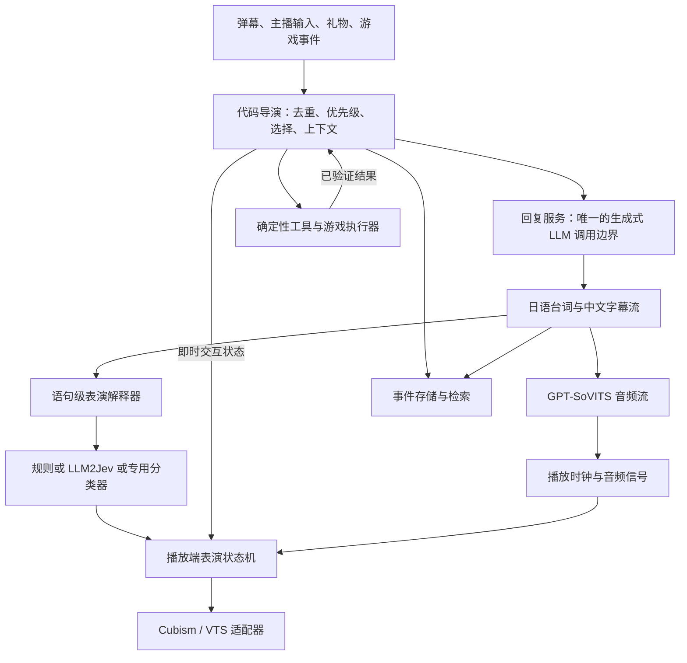

**LLM2Jev 与 Yachiyo 控制层重构评估**

日期：2026-09-22。项目基线：`63c615c`。LLM2Jev 核验版本：`6fbbf74fc604f92fc9b0b67f0989157bb2908229`。

部署目标按最新要求调整为：跨平台客户端、可用 Docker 部署后台；GPT-SoVITS 独立服务，回复模型使用服务商 API。本报告不以某个操作系统或显卡作为方案取舍条件。这是架构评估与迁移设计，尚未实施业务重构或部署。

**1. 结论与边界**

可以把项目重构为“生成式 LLM 只负责回复内容”的系统，Live2D 表情、动作、嘴型、生命周期和参数控制都可以摆脱生成式调用。建议采用代码主导的控制层，将 LLM2Jev 作为可替换的语义评分器，而不是让它成为新的总控制器。

需要准确区分两个目标：

| 目标 | 判断 |
| --- | --- |
| 除台词、字幕等回复内容外，不再让服务商 LLM 生成任何控制信息 | 可以实现，也是本报告推荐的目标 |
| 所有非回复流程完全不运行任何语言模型，包括本地模型的前向计算 | 使用 LLM2Jev 就不满足；可将其换成规则、专用判别式分类器、信号处理和传统规划算法 |
| 去掉生成模型后，保持任意自然语言任务规划、任意游戏目标、自由记忆总结的全部能力 | 不能仅凭 LLM2Jev 保证；必须定义支持范围，并补足解析、技能库、规划与评测 |

LLM2Jev 仍加载语言模型，对输入做前向计算；区别在于直接读取候选分数，不逐 token 生成控制 JSON。它不是 TypeSafe 官方 Jev 模型，也不继承官方模型的质量或速度保证。[上游说明](https://github.com/Yinsongxu/LLM2Jev/blob/6fbbf74fc604f92fc9b0b67f0989157bb2908229/README_zh.md)

**2. 本项目已有的基础，以及真正需要切断的依赖**

当前并非由 LLM 每帧生成面部参数。提示词已经要求模型只输出语义动作；代码负责把语义变为运动、表情资源和参数。因此，重构重点是语义控制权、调用边界和跨平台运行时，现有动画算法有大量可复用部分。

| 源码位置 | 当前行为 | 重构含义 |
| --- | --- | --- |
| [流式输出协议](/Users/yxy/Desktop/codex/yachiyo-live2d-studio/src/frontend/services/room/live2dLlmControl.js:1359) | 每句话按 BEAT → VOICE → CAPTION 输出，最后还有 CONTROL | 移除 BEAT 与 CONTROL 的生成要求，只保留回复内容协议 |
| [语句派发](/Users/yxy/Desktop/codex/yachiyo-live2d-studio/src/frontend/services/room/live2dLlmControl.js:458) | 优先采用 BEAT；没有时使用本地情绪规则 | 改为向独立表演解释器发布语句事件 |
| [行为编译器](/Users/yxy/Desktop/codex/yachiyo-live2d-studio/src/frontend/services/room/live2dBehaviorController.js:151) | 本地完成动作归一化、参数映射与约束 | 保留并收紧输入类型，不再接收聊天模型控制字段 |
| [共享表演核心](/Users/yxy/Desktop/codex/yachiyo-live2d-studio/src/frontend/services/room/live2dPerformanceBrain.js:82) | 状态机、动作过渡、连续性、表情占用规则 | 作为统一的表演运行时继续使用 |
| [角色状态机](/Users/yxy/Desktop/codex/yachiyo-live2d-studio/src/frontend/services/room/live2dCharacterStateMachine.js:588) | 本地计算角色状态与连续运动 | 与播放事件连接，独立于推理服务运行 |
| [Cubism 桥接](/Users/yxy/Desktop/codex/yachiyo-live2d-studio/src/frontend/services/room/live2dCubismBehaviorBridge.js:724)、[VTS 桥接](/Users/yxy/Desktop/codex/yachiyo-live2d-studio/src/frontend/services/room/live2dVTubeStudioBridge.js:1450) | 两者都使用共享表演核心 | 保留输出适配器，统一时间与参数所有权 |
| [GPT-SoVITS 快速音频路径](/Users/yxy/Desktop/codex/yachiyo-live2d-studio/src/frontend/services/room/live2dSpeech.js:693) | 直接加载流式音频；默认用合成嘴部波形 | 改进音频驱动嘴型，收益与 Jev 无关 |
| [记忆总结](/Users/yxy/Desktop/codex/yachiyo-live2d-studio/src/frontend/services/room/live2dMemory.js:893) | 每 10 轮使用主 LLM 生成总结 | 改为原文事件、抽取式记忆和检索整理 |
| [Minecraft 规划](/Users/yxy/Desktop/codex/yachiyo-live2d-studio/src/frontend/services/room/live2dMinecraftPlanner.js:224) | 先调用主 LLM，失败才用规则 | 改为代码生成合法计划，必要时由评分器选择 |

要彻底切断依赖，还必须同步修改非流式、恢复重试和兜底协议，以及 CONTROL 内的 `music`、`minecraftGoal`、`memory_writes`、`acknowledgedIndexes`。仅停止消费表情字段，模型仍会生成它们并产生费用；仅修改主路径，兜底又会恢复控制调用。

**3. LLM2Jev 能做什么，不能做什么**

其核心是“对候选逐个评分，再由代码组装结果”。Choice 有多少候选，就有多少个 yes/no 评分输入；Score 每个等级也是一个输入；无 criteria 的 Noul 为一个，有 true/false criteria 时为两个。多个评分可以批量执行或共享前缀，但一次 HTTP 请求不等于一次固定成本的模型计算。[编译代码](https://github.com/Yinsongxu/LLM2Jev/blob/6fbbf74fc604f92fc9b0b67f0989157bb2908229/src/llm2jev/inference/binary.py)

例如“6 种情绪 + 3 档强度 + 3 种视线目标”会展开成 12 个评分输入，本次运行上游编译函数已验证。实际方案中，视线通常可由当前交互对象直接确定，无需让模型再判断。不要将几十个 Live2D 参数分别做成问题，更不要逐帧调用。

目前有两条后端路径：SGLang 支持共享前缀，并提供 `/v1/systemone` HTTP 入口；Transformers 提供 Python 调用，当前实现批量前向时使用 `use_cache=False`，没有相同的共享前缀优化。若选后者作为独立服务，需要补应用层 HTTP 包装。普通聊天 API 不一定提供实现所需的 logits 接口，不能直接把服务商 URL 填进 LLM2Jev 当作等价后端。[使用指南](https://github.com/Yinsongxu/LLM2Jev/blob/6fbbf74fc604f92fc9b0b67f0989157bb2908229/docs/usage_zh.md)、[Transformers 实现](https://github.com/Yinsongxu/LLM2Jev/blob/6fbbf74fc604f92fc9b0b67f0989157bb2908229/src/llm2jev/backend/transformers/backend.py)

上游已支持图文输入，故前一份报告对官方 Jev 文本输入的说明不能套用到 LLM2Jev。不过，图像分类仍有模型成本；它不能直接替代连续追踪、音频分析或游戏环境的确定性状态读取。[多模态说明](https://github.com/Yinsongxu/LLM2Jev/blob/6fbbf74fc604f92fc9b0b67f0989157bb2908229/docs/multimodal_zh.md)

另一个重要区别是 confidence：它反映归一化分布的集中程度，不是经过验证的正确率。本次向上游组装函数输入人工构造的两个低适配分数 `0.001` 和 `0.000001`，结果 confidence 仍为 `0.9980`。这是数学行为演示，不是真实模型误判测试。应包含 neutral/保持现状/无法判断等候选，必要时保留原始适配分数，并在业务数据上校准；不能直接套用官方 Jev 阈值。[概率组装代码](https://github.com/Yinsongxu/LLM2Jev/blob/6fbbf74fc604f92fc9b0b67f0989157bb2908229/src/llm2jev/inference/assembler.py)、[算法说明](https://github.com/Yinsongxu/LLM2Jev/blob/6fbbf74fc604f92fc9b0b67f0989157bb2908229/docs/request-to-model_zh.md)

**4. 建议的运行架构**



导演决定何时回应谁、需要哪些上下文；回复模型决定说什么；表演解释器判断怎样表达这句话；状态机决定动作如何展开；音频时钟决定什么时候张嘴、停顿和结束。

回复模型只需要日语台词和对应中文字幕。两者都是用户可见内容，可在同一次生成中输出。保留少量内容分隔符不等于保留机器控制职责。若要求模型连字幕都不生成，则需要单独翻译模型或改为单语；LLM2Jev 不承担翻译。

工具意图来自原始输入和可信事件，执行结果由工具回报。不要再从角色说出的“我去挖矿啦”反向触发挖矿，也不要让回复模型在尾部补发点歌、记忆写入或目标变更。

建议内部统一使用由代码构造的事件，示意如下：

```ts
type PerformanceCue = {
  sessionId: string;
  turnId: string;
  utteranceId: string;
  revision: number;
  style: 'neutral' | 'warm' | 'playful' | 'sad' | 'surprised' | 'firm';
  energy: number;              // 代码归一化并限幅
  target: 'chat' | 'camera' | 'game';
  onsetAudioMs: number;        // 相对于本句实际音频播放起点
  expiresAfterAudioMs: number;
  source: 'rule' | 'scorer' | 'manual';
};
```

这是拟议的应用协议，不是要求 LLM 生成的新 JSON。评分器只提供有限标签或分数，ID、时间、版本、优先级、持续时间和允许的动作组合由代码填写。过期、已打断或其他轮次的结果不得作用于当前角色。

**5. Live2D：按控制频率与参数所有权拆分**

| 控制内容 | 应由谁负责 | 触发方式 |
| --- | --- | --- |
| 倾听、等待回复、说话、打断、恢复待机 | 事件驱动状态机 | 输入与播放生命周期 |
| 眨眼、呼吸、小幅摆动、视线微动 | 程序动画 | 播放端逐帧计算 |
| 嘴部开合 | 音频能量或音素信息 | 使用实际播放时钟 |
| 笑容、眉形、眼神及语气风格 | 语句级语义判断 + 本地映射 | 一句或语义明显变化时 |
| 点头、歪头、挥手等动作组合 | 行为库与调度规则 | 有限表演事件 |
| 礼物反应、手动表情、游戏受伤反应 | 已知事件对应模板 | 事件发生时立即触发 |
| 泪滴、火焰、吐舌等显著特效 | 显式事件或经验证的语义条件 | 独立冷却与互斥 |
| 骨骼角度、插值、参数范围、物理 | 动画引擎与模型适配器 | 逐帧计算 |

基础动画以播放端 30/60 Hz 等配置频率运行；模型判断以语句或事件为单位。两条频率完全分离。推理服务不可用时，角色仍然能听、看、呼吸、说话和正常收口，只是采用已有情绪或中性表演。

表演的自然程度取决于连续性，不只取决于标签准确率。应保留当前已有的动作交接和平滑机制，增加情绪保持时间、切换迟滞、动作重复抑制与稀有表情冷却。它们属于可调的演出参数，不应交给 LLM 临时填写。

参数需要有明确的组合规则：音频拥有嘴部开合；笑容控制嘴形；表情占用闭眼时眨眼应让位；头部动作与视线按限幅规则合成；物理由原有引擎推进。当前代码已有眼部占用处理，应在统一组合层中保留并验证，避免两个桥接器或多个动画层互相覆盖。

**6. 表情识别要识别角色的表达，而非关键词**

本次直接调用当前 `analyzeLive2DSentenceEmotion`，得到：

| 输入 | 当前返回 | 暴露的问题 |
| --- | --- | --- |
| 我没有生气。 | angry | 未处理否定 |
| 别哭泣了，我陪着你。 | crying | 将安慰对象的状态投射给说话者 |
| 泣いても大丈夫、そばにいるよ。 | crying | 日语安慰表达也可能触发哭泣 |
| 今日は本当に楽しかった、ありがとう！ | neutral | 日语积极表达覆盖有限 |

这些是当前规则的可复现实例，不是 LLM2Jev 的评测结果。新评分器尚未加载真实模型，不能宣称它已经解决上述问题。

评分上下文建议只保留：当前台词、必要的上一句或被回应内容、角色当前情绪、事件类型。问题应是“角色表达本句时应采用哪种表演风格”，而不是“文本中出现了哪种情绪”。先做少量风格候选及低/中/高强度，动作与表情资源从现有注册表选择。[表情注册表](/Users/yxy/Desktop/codex/yachiyo-live2d-studio/src/frontend/constants/room/yachiyoExpressionPresetRegistry.js)

用中文、日语、否定、引用、反话、安慰、玩笑、跨句情绪和中途打断做离线评测。保持一个规则提供器作为可运行基线；LLM2Jev 的效果确实更好才启用。以后可用人工标注的直播数据训练专用分类器，替换同一接口，从而连控制侧语言模型的前向计算也去掉。

**7. GPT-SoVITS 与嘴型：还有独立于 Jev 的改进空间**

当前快速音频路径把 `mouthMode` 设为 `synthetic`，嘴型主要来自播放时间和文字长度构造的正弦脉冲；另一条完整音频路径才会解码音频生成能量包络。因此，“嘴巴正在动”不代表它在跟踪实际音量。[合成嘴型](/Users/yxy/Desktop/codex/yachiyo-live2d-studio/src/frontend/services/room/live2dSpeech.js:574)、[快速加载](/Users/yxy/Desktop/codex/yachiyo-live2d-studio/src/frontend/services/room/live2dSpeech.js:670)

建议在保持流式播放的前提下，从实际播放音频提取能量，或让 TTS 适配服务同步提供带时间戳的音频包络。以音频播放时间驱动开合，加噪声门、attack/release 平滑和结束归零。如果未来 TTS 确实提供音素时间，再扩展口型；不能假设当前接口已经具备该能力。不要为了获得整段音频包络而等完整 WAV 下载后才播放。

当前直接 GPT-SoVITS URL 的参数包括文本、参考音频、语言和流式选项，没有传入每句的 `speechStyle`。所以模型生成 `pitch`、`speed` 并不意味着这个快速路径已经按这些字段合成。TTS 适配层应声明自己实际支持的参数；表情分类与声音表现需要分别验收。[URL 构造](/Users/yxy/Desktop/codex/yachiyo-live2d-studio/src/frontend/services/room/live2dSpeech.js:369)

**8. 其他流程如何移除生成式控制调用**

| 流程 | 替代方案 | 能力边界 |
| --- | --- | --- |
| 弹幕筛选、优先级、礼物确认 | 规则、队列、公平性、事件状态；模糊内容可评分 | 被选中不代表已回应，确认状态应跟随实际内容与播放 |
| 回复节奏、打断、重试、取消 | 代码状态机与明确的超时策略 | 不因评分失败而偷偷调用聊天模型生成控制 |
| 记忆写入与整理 | 保存来源明确的原始事件，抽取片段或固定字段，去重、排序、检索 | 自由的抽象总结与未来推断不会自动得到等价替代 |
| 点歌与音乐控制 | 命令解析、文本跨度抽取、搜索后候选排序、FIFO | Choice 不能凭空生成未给出的歌名；需要解析原输入或搜索候选 |
| Minecraft 日常行动 | 技能库、行为树或 GOAP、状态前置条件、确定性执行器 | 任意开放目标需要可解析的目标表示和足够的技能覆盖 |
| Minecraft 下一技能选择 | 代码生成合法候选，规则或 LLM2Jev 选择候选 ID | 坐标、数量、路径、材料和执行成功由代码计算与验证 |
| 桌面/场景信息 | 客户端采集、游戏结构化状态、按需视觉识别 | 图文评分只能回答已有问题，不能替代所有开放视觉理解 |
| ASR/TTS | 各自专用模型与服务 | 它们仍是必要的语音处理模型，不是聊天控制调用 |

付费事件等必须确认的输入，可由代码生成确定性的称呼/致谢内容，并单独记录播放完成；一般批量回复仍需核验是否真正回应，不能删掉 `acknowledgedIndexes` 后直接把所有候选标成已答。

严格模式下，游戏规划失败应观察、暂停、使用已知技能或记录不支持，不能回退到生成式规划。若游戏需要口头说明，只将真实执行结果送入回复服务生成播报；应按重要事件播报，避免每步动作新增一次内容调用，抵消规划降本。

**9. 跨平台与 Docker 的实际改造范围**

当前 API 网关位于 Windows WinForms/WebView2 启动器中，包含聊天代理、TTS/ASR、桌面采集、音乐、记忆和游戏入口。浏览器前端能编译，不等于整套后端已跨平台。[API 路由](/Users/yxy/Desktop/codex/yachiyo-live2d-studio/tools/live2d-launcher/Live2DStudioLauncher.cs:942)

建议将无界面业务抽入独立 Node/TypeScript 服务，共享现有 JS 模块与协议；Windows 启动器退化为可选客户端壳。也可保留 C# 实现跨平台后台，但必须解除 WinForms、WebView2 与平台采集 API 的依赖；Docker 本身不会完成这部分重构。

| 部件 | 建议部署位置 | 职责 |
| --- | --- | --- |
| Web UI、舞台、表演运行时 | 播放端浏览器/桌面壳 | 渲染、音频播放、逐帧控制 |
| 应用运行时与 API 网关 | Docker 或原生进程 | 唯一导演、会话、回复 API 适配、工具编排、事件流 |
| decision 服务 | 独立容器或远程服务 | LLM2Jev/SGLang，或其他分类器；固定模型与问题版本 |
| GPT-SoVITS 适配服务 | 独立容器或已有服务 | 合成、音频流、可选时间信息 |
| 记忆、音乐、Minecraft | 按现有组件划分 | 存储与工具执行；可用 Compose 按需启用 |
| 宿主连接器 | 实际播放/采集机器 | VTS、桌面采集、本地文件和设备能力 |

无需为了每个逻辑模块创建一个容器。应用内可以是模块化单体，Python 推理/TTS 和确有独立生命周期的工具再分服务。前端通过同源 API 与 SSE/WebSocket 接收结果，逐帧参数不经过远程 decision 服务。

跨平台迁移还需要具体处理这些现有依赖：

- Memory、Minecraft、ASR 服务目前绑定 `127.0.0.1`；容器内需配置监听地址和服务发现。客户端的 localhost、应用容器的 localhost、TTS 所在机器的 localhost 是不同位置。[记忆服务](/Users/yxy/Desktop/codex/yachiyo-live2d-studio/tools/memory/memory-data-service.mjs:3962)、[游戏服务](/Users/yxy/Desktop/codex/yachiyo-live2d-studio/tools/minecraft/minecraft-agent-service.mjs:31)、[ASR 服务](/Users/yxy/Desktop/codex/yachiyo-live2d-studio/tools/asr/vosk_asr_service.py:148)
- 会话与配置不能继续只由某个标签页的 localStorage 决定；服务端保存直播状态、工具队列与持久数据，客户端保留展示偏好。API 密钥通过服务端配置注入。[现有存储接口](/Users/yxy/Desktop/codex/yachiyo-live2d-studio/src/frontend/services/room/roomStorage.js:1)
- 多个浏览器连接同一直播间时，只允许一个活动播放端提交播放确认和控制输出；其他客户端作为观察/控制界面。不能每开一个页面就启动一套导演和自主游戏循环。
- 音频代理必须持续转发流，前端以实际开始播放为时间零点；不能改成收完音频再返回。容器或远端时钟不直接用作嘴型时间。
- 模型、参考音频、Live2D 资源与记忆数据库使用配置路径/持久卷；由部署层管理后台服务生命周期，移除后台里启动 Docker Desktop 或桌面 EXE 的假设。

**10. 延迟与成本：收益来自哪里**

最直接的变化是去掉台词前的 BEAT。当前提示中的示例 BEAT 为 185 个 Unicode 字符，本次完整流式控制提示为 2,776 个 Unicode 字符，均不是 token 数，也不等于每次实际输出长度。模型先生成这些控制信息才开始 VOICE，确实处于首句路径上；末尾 CONTROL 则主要增加整轮完成时间、输出费用和尾部解析复杂度。

新流程应让台词到达后，TTS 与表演评分同时开始。首句采用已知状态或中性表情即可启动；评分结果及时到达则在有效时间窗内渐变应用，迟到则保持或丢弃。若要用新评分决定本句 TTS 风格，就产生新的依赖，应采用有截止时间的策略，不能无条件阻塞音频。

对没有前序播放积压的一句，简化理解为：

```text
旧首音频 ≈ 调度 + 必需上下文 + 生成 BEAT 和 VOICE
          + max(TTS 就绪, 字幕就绪) + 播放启动

新首音频 ≈ 调度 + 必需上下文 + 生成 VOICE
          + max(TTS 就绪, 字幕就绪) + 播放启动

表演评分在旁路执行，不成为新的必需等待项。
```

现有字幕门控、上下文等待、播放积压和角色停顿仍需分别测量。允许字幕稍晚出现可以作为产品选项；如果保留严格同步，字幕等待仍在首音频路径上。改用 Jev 不会自动消除它。[播放门控](/Users/yxy/Desktop/codex/yachiyo-live2d-studio/src/frontend/services/room/live2dSpeech.js:790)

成本应比较：被移除的控制输出 token、控制提示输入、独立规划/总结/翻译兜底调用，与新增评分服务计算、运行维护和可能增加的上下文成本。BEAT/CONTROL 原本随同一次回复输出，删除它们通常节省 token，不等于每句少了一次聊天 API 调用。记忆改为抽取式后也可能需要更多检索文本，应把这部分纳入账单比较。

上游基准在模型预热、串行请求的指定环境中，9 候选样例的中位耗时为 36.43ms；但两候选短输入中 staged 为 19.11ms，all 为 11.49ms。它比较的是 LLM2Jev 两种提交方式，不能用于宣称本项目会快多少倍，也不是 TTS 同时工作时的 p95。应使用实际语句长度和候选数选择模式。[作者基准与条件](https://github.com/Yinsongxu/LLM2Jev/blob/6fbbf74fc604f92fc9b0b67f0989157bb2908229/docs/shared-prefix-benchmarks_zh.md)

**11. 推荐迁移顺序与验收**

| 阶段 | 具体改造 | 完成标准 |
| --- | --- | --- |
| 1：定义边界 | 分离 ReplyService、Director、PerformancePolicy、ToolExecutor；添加 turn/utterance/event ID 与分阶段遥测 | 能区分模型、字幕、TTS、队列和动作等待；所有生成调用有明确用途 |
| 2：Live2D 脱钩 | 删除所有路径的 BEAT/CONTROL 表演职责，接入代码表演策略，修正流式嘴型 | 断开评分器后仍能完整播报、眨眼、待机与打断；旧事件不污染新句 |
| 3：验证 LLM2Jev 增量 | 接入独立 decision 服务，先只记录判断，再启用经评测的标签 | 在同一批中日语样本上优于规则基线；错误、覆盖率、耗时可解释 |
| 4：清除其他控制生成 | 迁移点歌、记忆、确认逻辑、Minecraft；取消生成式控制兜底 | 非回复模块不持有聊天客户端；分类失败走代码策略；重要事件确认和既有技能通过回放 |
| 5：后台跨平台化 | 从 C# 壳拆出 API/调度，补 Compose、配置、卷和宿主适配 | 浏览器可连接后台；重启与重连不重复执行；多客户端不重复播放 |

阶段 1 就应定义跨平台接口，阶段 5 才完成部署迁移，避免先写死平台再改第二遍。现有记忆持久化、队列、动作连续性与安全前置条件应逐项迁移，不能在重构时仅保留画面和对话。

验收至少记录：首音频 p50/p95、字幕等待、每小时回复 token、非回复生成调用次数、评分耗时/失效率、表情与台词匹配率、音画同步、重要观众漏答、游戏技能成功率、记忆来源可追溯性。增加评分服务故障、TTS 故障、中途打断和旧结果迟到的回放测试。

最终运行约束应是：只有回复服务可以调用生成式聊天 API；工具与表演只接收经验证的事件和有限数据。不能把控制规划藏进“思考回复”的提示里，再解析思考或台词执行动作。

**12. 本次核验范围**

- 阅读了项目的生成、语音、表演、状态机、记忆、游戏和 Windows 网关实现，以及指定 LLM2Jev 版本的后端、协议与测试。
- 在隔离的临时 Python 环境运行上游测试：134 项中 124 通过、10 项因未安装可选 Pillow 跳过。主要验证数据结构、评分组装和模拟后端；没有安装推理引擎、下载权重或验证真实语义质量。
- 直接运行了项目情绪规则样例、LLM2Jev 候选展开及置信度组装演示。
- 前一轮项目构建通过，现有 85 个回归脚本中 84 通过、1 个源码切片断言失败；详情见[前一份项目报告](/Users/yxy/Desktop/codex/yachiyo-live2d-studio/docs/project-analysis-and-jev-evaluation.md)。本轮没有修改业务代码，未重复全量运行。
- 没有执行真实直播、模型推理、GPT-SoVITS/VTS 联调或容器部署。此时可以确认职责拆分的工程可行性，不能承诺具体降本比例、延迟或表演质量提升幅度。
