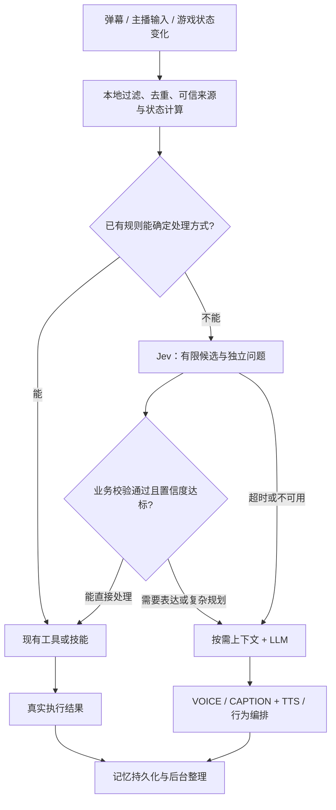

**Yachiyo Live2D Studio：项目分析与 Jev 接入评估**

评估日期：2026-09-22。源码基线：`63c615c`。本报告基于源码、构建、现有回归脚本，以及 TypeSafe 官方文档；未调用 Jev 或真实 LLM/TTS 服务。所有收益数字中，测试结果、厂商报价与假设算例分别标明。

后续要求已收紧为“生成式 LLM 只负责回复内容”，并允许跨平台 Docker 部署。针对 LLM2Jev、Live2D 完整脱钩与后台迁移的最新结论见[重构评估](/Users/yxy/Desktop/codex/yachiyo-live2d-studio/docs/llm2jev-control-refactor-assessment.md)。本篇保留早期官方 Jev 评估，其中“复杂规划回退 LLM”不属于最新严格控制边界。

**1. 判断与优先级**

可以引入 Jev，但应把它作为可选的语义决策服务。优化顺序应是：本地规则处理明确任务，Jev 处理有限选项中的模糊判断，生成模型处理表达和复杂规划。

最大降本候选是 Minecraft 日常技能选择；直播首句延迟则应优先检查上下文准备、中文字幕等待、TTS 和播放排队。给所有消息统一加一个 Jev 前置请求，可能只增加网络延迟与费用。

项目目前是功能覆盖较完整、偏 Windows 的 AI VTuber 工作室。Vue 3/Vite 负责界面与交互；C# WinForms/WebView2 启动器兼任本地 API 网关；Node 服务承载记忆、音乐、ASR 和 Minecraft。最终模型输出可走 VTube Studio，也有本地 Cubism 预览。详细运行流程见 [README](/Users/yxy/Desktop/codex/yachiyo-live2d-studio/README.md:72)。

**2. 已完成的验证与工程问题**

| 检查 | 结果及含义 |
| --- | --- |
| 依赖与运行时 | 原工作区没有 node_modules，系统 PATH 没有 Node；本次用随附 Node 24.19.0 按 package-lock 安装依赖 |
| 前端构建 | 成功；输出到临时目录，HTML/CSS/JS 与仓库已提交产物逐字节相同 |
| 前端体积 | 入口 JS 约 1,017.62 kB，gzip 343.43 kB；Vite 提示大 chunk。这影响加载与初始化，不能直接等同于对话推理延迟 |
| 回归脚本 | 执行 tools/live2d-studio 下 85 个 mjs 脚本：84 通过、1 失败；另一个需要 Windows PowerShell 的脚本未运行 |
| 失败归因 | test-managed-milvus-policy.mjs 的源码 slice 终点误命中较早的 Minecraft 代码，得到空字符串；按起点限定终点后，两条相关保护断言通过。原测试仍为失败，未修改源码 |
| 记忆测试 | 600 轮、3 次重启测试通过；50,025 条全局记忆的观众隔离测试通过。这是本地测试数据，不是直播端到端性能基准 |
| 未覆盖 | Windows EXE/WebView2 真实启动、VTS/OBS、真实 B站/网易云、真实 Minecraft 世界、实际模型费用与首音频延迟；tools/music 两个依赖外部服务的探测脚本未运行 |

失败位置见 [测试脚本](/Users/yxy/Desktop/codex/yachiyo-live2d-studio/tools/live2d-studio/test-managed-milvus-policy.mjs:66)，实际保护逻辑见 [启动器](/Users/yxy/Desktop/codex/yachiyo-live2d-studio/tools/live2d-launcher/Live2DStudioLauncher.cs:4470)。

工程上应先处理三件事：

- 开发服务缺少完整 API 网关。Vite 配置只实现部分 B站/素材接口，没有 chat、memory、vision、minecraft 等通用代理；因此 macOS 上仅运行 dev 不等于能运行整套功能。[Vite 配置](/Users/yxy/Desktop/codex/yachiyo-live2d-studio/live2d-studio/vite.config.js:433)
- 测试很多，但 package.json 没有统一 test、lint、typecheck 脚本，仓库没有已提交的 GitHub Actions 配置；部分测试靠源码字符串匹配，容易出现这次的失效。[package.json](/Users/yxy/Desktop/codex/yachiyo-live2d-studio/package.json:7)
- 核心文件过大：启动器 6,707 行，记忆服务 3,970 行，主页面 2,951 行，LLM 控制 1,911 行。接入决策服务时应抽出接口，避免继续把调度、协议和 UI 堆在同一文件。另外 package.json 的 Node >=20 范围比锁定 Vite 的要求更宽，应统一运行时要求。[锁定依赖](/Users/yxy/Desktop/codex/yachiyo-live2d-studio/package-lock.json:5216)

**3. 现有管线已经优化了什么，还会在哪里等待**

直播链路不是完全串行：记忆、视觉和 Minecraft 上下文通过 Promise.all 并行准备；LLM 输出 VOICE/CAPTION/CONTROL；语音按句入队；播放时预取下一轮；历史按请求顺序提交；记忆 outbox 在后台排空。这些机制应保留。[上下文入口](/Users/yxy/Desktop/codex/yachiyo-live2d-studio/src/frontend/services/room/live2dLlmControl.js:1508)、[生成与播放管线](/Users/yxy/Desktop/codex/yachiyo-live2d-studio/src/frontend/services/room/live2dTurnPipeline.js:20)

但是，“并行准备”仍要等最慢的必需结果。默认启用记忆和桌面视觉；记忆搜索超时为 2 秒，视觉采集超时为 2.6 秒。这是代码等待上限，不能当作正常耗时。Minecraft 状态有缓存，但启用时也可能成为等待项。[记忆搜索](/Users/yxy/Desktop/codex/yachiyo-live2d-studio/src/frontend/services/room/live2dMemory.js:522)、[视觉采集](/Users/yxy/Desktop/codex/yachiyo-live2d-studio/src/frontend/services/room/live2dVision.js:73)

更关键的是字幕：音频可以提前准备，但播放前会 await startGate，只有拿到中文字幕才放行。主流式字幕迟到时，页面约 300ms 后启动额外翻译兜底；该翻译使用同一个主 LLM。即使音频已准备好，字幕仍可能挡住首音频。兜底已经发出后，原字幕先返回也没有独立取消兜底请求的机制，可能产生无用调用。[字幕竞速](/Users/yxy/Desktop/codex/yachiyo-live2d-studio/src/frontend/services/room/live2dCaptionSynchronizer.js:55)、[播放门控](/Users/yxy/Desktop/codex/yachiyo-live2d-studio/src/frontend/services/room/live2dSpeech.js:790)、[页面集成](/Users/yxy/Desktop/codex/yachiyo-live2d-studio/src/frontend/pages/Live2DPage.vue:1345)

因此，对无历史播放积压的一轮，可用下式理解主要路径：

```text
首音频延迟 ≈ 输入调度
           + max(必需记忆、必需视觉、必需游戏状态)
           + LLM 首个可用语句
           + max(首句音频就绪、首句字幕就绪)
           + 播放启动开销
```

存在积压时，还要考虑上一轮播放结束与人为停顿的约束；预取会重叠部分阶段，不能简单把所有平均值相加。普通流量下回复间隔本来就采样 1.1–2.1 秒，低流量为 1.7–3 秒，另有概率触发思考停顿。这些是角色节奏，不是 API 性能问题。[导演调度](/Users/yxy/Desktop/codex/yachiyo-live2d-studio/src/frontend/services/room/live2dDirectorScheduler.js:1)

Minecraft 已在执行当前动作时预取下一个 LLM 计划，并用本地任务接口每 250ms 检查结束。250ms 是状态轮询频率，不是 LLM 调用频率。如果计划早已在动作完成前返回，换 Jev 主要节约成本，对动作衔接改善有限。只有规划比执行更慢时，模型提速才减少等待。[自主控制器](/Users/yxy/Desktop/codex/yachiyo-live2d-studio/src/frontend/services/room/live2dMinecraftAutonomy.js:87)

**4. 对文章主张的核验**

用户提供的 [Eigent 文章](https://www.eigent.ai/zh-CN/blog/typesafe-ai-jev-system-one-models) 介绍了 System One 决策层。接入规格以下列官方文档为准。

Jev 接收文本/结构化状态与问题，返回 Choice、Score、Noul。它适合分类、排序与有限候选选择，不能承担自然对话、字幕翻译或图像理解。多个问题可在一次请求中独立评估，但问题之间不会自动读取彼此的答案；跨字段业务一致性仍需代码验证。[官方介绍](https://docs.typesafe.ai/introduction)、[API](https://docs.typesafe.ai/api)

当前文档列出 jev-1.13.0，输入 $0.042/百万 token、输出免费；每请求总输入上限 64k，state 加最长问题上限 32k。报价是核验当天的数据；问题文本也占输入，不能只计算用户消息。文档说明英文效果最佳，中文、日文需自行验证。[模型与价格](https://docs.typesafe.ai/models)

“类型正确”不代表“判断正确”。Choice/Score 的 confidence 来自概率分布形状，不能把 confidence=0.9 直接解释为本项目中 90% 正确；Noul 没有同名 confidence 字段。阈值必须按任务、模型版本、语言分别校准。[置信度说明](https://docs.typesafe.ai/confidence)

官方明确列出数字计算、多跳推理、冗余长状态、对抗输入等局限。直播弹幕可能试图操纵分类，不能让 Jev 取代现有身份来源、敏感内容过滤或动作白名单。它也不适合计算 Minecraft 坐标、材料数量和技能前置条件。[已知局限](https://docs.typesafe.ai/model-jaggedness/jev-1.13)

首页宣传的 193.6 倍速度和 444.6 倍成本优势针对其 System One 工作流，不是本项目的实测结果。模型服务延迟也不等于用户所在网络到 API 的往返延迟。[厂商主页](https://typesafe.ai/)

**5. 适合接入的位置**

| 场景 | 当前实现 | 建议 | 对收益的判断 |
| --- | --- | --- | --- |
| Minecraft 常规生存 | 每次规划调用主 LLM，失败后才走确定性 fallback | 把明确生存规则前置；剩余候选交 Jev；复杂目标/反复失败交 LLM | 最明确的模型调用削减入口，但先比较“仅规则”方案 |
| 对话上下文选择 | 启用时每轮准备记忆、视觉、游戏状态 | 规则或 Jev 判断是否需要各类上下文 | 可减少输入和慢请求等待；分类新增耗时必须小于省下的等待 |
| 模糊点歌 | 明确命令已有本地正则与独立执行路径 | 只对未命中规则的意图、候选歌曲做判断 | 明确点歌不应多一次模型请求；总体收益取决于模糊请求占比 |
| 记忆候选评分 | 持久化 outbox、每 10 轮 LLM 总结 | 后台评估重要性、重复性、候选相关度 | 可减少部分总结/上下文；不能替代事实生成、持久存储或向量检索 |
| 弹幕话题/回应价值 | 本地限流、公平选择、礼物确认 | 为已筛出的候选补充语义分数 | 主要改善选择质量，现有规则本身没有 LLM 成本可省 |
| 表情/动作 | 随语句分析和行为编排执行 | 优先保留本地映射，可离线评估语义补充 | 单独新增 Jev 调用通常不利首句延迟 |
| 对话、翻译、TTS、实时嘴型 | 生成模型/音频/本地逐帧控制 | 保留原能力，分别优化 | Jev 不能替代这些模块 |

Minecraft 规划系统提示实测为 6,319 个 Unicode 字符，其中核心人格为 2,479 字符，尚未计入世界状态。这里没有把字符数冒充 token 数。规划始终使用 roomLLMSettings，超时上限 45 秒；已有 fallback 能覆盖生存课程、食物、庇护所和资源采集。[规划入口](/Users/yxy/Desktop/codex/yachiyo-live2d-studio/src/frontend/services/room/live2dMinecraftPlanner.js:224)、[现有规则](/Users/yxy/Desktop/codex/yachiyo-live2d-studio/src/frontend/services/room/live2dMinecraftPlanner.js:65)

**6. 建议的管线设计**



这不是每条输入都必须走完的固定串行链：明确的普通对话可以直接进入表达路径；低风险分类可利用播放等待窗口提前完成。对时限敏感的分类，超过预算就使用现有路径，迟到结果不再改写已经发出的这一轮请求。

Minecraft 应由代码根据已验证的世界状态生成少量完整候选，例如“执行 bootstrap_survival”“执行 secure_food”“沿已有矿道继续”“观察”“交复杂规划”。Jev 只选择 candidateId，代码再取回完整动作。不要分别让模型选择 x、y、z、方块和技能，再把可能冲突的答案拼起来；数量、位置、路径可达性均由代码负责。执行前复查 goalVersion、世界版本、安全锁和资源前置条件。

Jev 的多问题并行适合一次询问 route、needs_memory、needs_vision、候选语气等互不依赖的问题。检索后的候选排序必须等检索完成；下一步动作必须等真实执行状态验证。不能因“并行”而省略这些依赖。[并行问题模式](https://docs.typesafe.ai/patterns/fan-out)、[有限参数工具选择](https://docs.typesafe.ai/cookbooks/function_calling)

建议新增独立的本地 decision API/adapter，单独保存 provider/model 配置；不要把 Jev URL 填进现有聊天接口，它不是 chat/completions 协议。HTTP 入口是 POST /v1/systemone，也有 ESM JavaScript SDK。[HTTP 规格](https://docs.typesafe.ai/api)、[JS SDK](https://docs.typesafe.ai/sdk/javascript)

调用层应统一承担超时、取消、幂等、缓存、版本和计量。缓存键至少包含问题版本、模型版本、状态/目标版本；观众相关数据还需可信观众 ID。把 API key 留在本地服务。SDK 默认单次超时 10 秒且可重试，不宜直接作为直播时间预算；例如可先试验 300–500ms 的总预算，实际阈值由部署网络的 p95 和回退率决定。[SDK 配置](https://docs.typesafe.ai/sdk/javascript/api/interfaces/TypeSafeClientConfig)

主播修改游戏目标的权限、礼物事件真实性和危险动作拦截继续由代码决定，不能由 Jev 的置信度授予。遇到不确定结果，普通对话回退 LLM，游戏状态不完整则观察/等待，而不是放宽执行条件。

**7. 延迟与成本的可验证条件**

针对仍需生成回复的请求，Jev 前置分类只有在下式成立时才缩短首句路径：

```text
新增分类的不可重叠耗时
  < 省掉的上下文等待 + 减少输入后节约的模型耗时
```

如果语音合成或字幕等待才是瓶颈，分类提速不会直接解决它。优先增加语句级 ID 和音频就绪时间，区分“还没生成音频”“音频已就绪但等字幕”“排队等上一句结束”。对于必须中日同步的产品模式，优化双语成对输出和翻译兜底竞速；如果未来提供允许字幕稍后补上的低延迟模式，应作为明确的产品选项，不在此次分析中改变现有行为。

Minecraft 已有预取时，动作之间的规划等待可近似看成：

```text
衔接等待 ≈ max(0, 下一计划耗时 - 当前动作剩余执行时间) + 状态确认开销
```

应在状态显著变化、技能结束、目标变更时决策，不要在每个 250ms 本地轮询上调用 Jev。低血量、死亡、资源计数等确定性状态仍走本地规则。

成本用模型调用账单而非消息条数计算。设规则已经处理完明确任务，剩余 N 次原本需要 LLM 的决策；其中新增 M 次 Jev 调用、仍有 q 比例回退同一 LLM：

```text
旧成本 = N × 单次 LLM 成本
新成本 = M × 单次 Jev 成本 + N × q × 回退 LLM 成本
         + 重试 / 验证 / 新增生成成本
```

以下只是敏感性算例，不代表当前 API 设置或真实收益：N=M=100,000，Jev 每次总输入 1,200 token；旧 LLM 每次输入 3,000、输出 250 token，假设单价分别为 $1/百万与 $4/百万，则旧成本 $400，Jev 部分 $5.04。

| 仍需原 LLM 的比例 q | 假设新成本 | 相对旧成本 |
| --- | ---: | ---: |
| 30% | $125.04 | 减少约 68.7% |
| 70% | $285.04 | 减少约 28.7% |
| 100% | $405.04 | 增加约 1.3% |

表格忽略重试、工具、TTS、部署和迁移成本，也假设回退 LLM 的单次成本不变。主直播仍需人格化生成时，不能把每个 Jev 分类都记为“省掉一次 LLM”。模型本来很便宜、日用量很少或多数情况都回退时，开发成本可能超过账单节约。实际 Jev 费用应使用返回的 usage.input_tokens，包括状态和所有问题。[计费依据](https://docs.typesafe.ai/models)

**8. 落地与验收**

第一步先补基线：利用已有 live2dReplyTelemetry，加入 context-start/end、llm-dispatch/first-token、audio-ready、caption-wait、playback-queue、sentenceId，以及 provider/model/token usage。当前 llm-start 事件在上下文准备之前发出，会把检索等待混进“LLM 耗时”。同时统计 Minecraft 的实际规划次数、预取丢弃率、计划耗时与动作成功率。[现有遥测](/Users/yxy/Desktop/codex/yachiyo-live2d-studio/src/frontend/services/room/live2dReplyTelemetry.js:1)

第二步做不依赖 Jev 的优化：在适用的目标下前置现有 Minecraft 生存规则；让规划器与播报器分别使用所需提示和模型设置；让纯音乐命令避免不必要的游戏/视觉上下文；减少字幕竞速中的无用翻译。保留观众公平性与付费消息确认语义。

第三步用三组对照验证 Jev 增量价值：A 为现有系统，B 为规则与管线优化，C 为 B 加 Jev。先仅记录 Jev 决策、不执行，再对低风险、候选明确的场景有限启用。评估集应按会话划分，覆盖中文/日文、否定、反话、模糊点歌、上下文缺失和恶意弹幕；用人工标注及真实执行结果衡量质量，不只看与原 LLM 是否一致。

验收指标至少包括首音频 p50/p95、每小时 token 费用、每个成功动作成本、回退/超时率、重要观众漏答率、记忆事实保持率与游戏动作失败率。记录高置信度覆盖率和其错误率，按模型版本固定阈值；同时保持一个可立即回退的开关。

初次试点优先选择 Minecraft“已有合法技能候选的选择”，并单独测量普通直播首音频。在没有真实 Jev 调用和部署地区延迟数据前，本报告只能确认架构可行性与可测收益条件，不能给出可靠的全项目降本百分比或毫秒收益。
